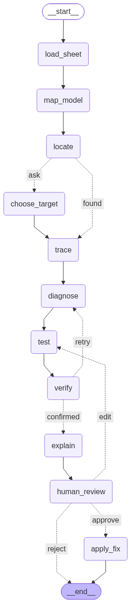

# Model X-Ray

**The debugger for financial models.** Model X-Ray is an evidence-first Nemotron agent that investigates surprising outputs in financial spreadsheets. Given a question such as "Why did EBITDA jump in 2030E?", it locates the cell behind the question, traces the dependency graph, diagnoses the root cause, tests a fix in a sandbox copy of the workbook, verifies the result, explains it with clickable evidence, and returns a corrected copy — only after a human approves the change.

Every number it reports comes from deterministic code or from the spreadsheet's own recalculation. The LLM never does arithmetic and may only quote tool results; a wrong hypothesis is shown, rejected with evidence, and replaced rather than quietly dropped.

## Demo scenario

The repository ships a generated NVIDIA P&L model with one planted error:

- `demo/nvidia-pnl.xlsx` — clean: two sheets (Assumptions, P&L), FY2025–FY2032, typed actuals and public estimates, every forecast cell a formula.
- `demo/nvidia-pnl-error.xlsx` — identical, except `P&L!G11` (Total operating expenses, 2030E) is a typed `45.0` where the row uses `=SUM(G7:G10)`. EBITDA margin spikes to 71.2% against 68.5% / 68.9% on either side.

Run the API and investigate it:

```bash
MODEL_X_RAY_MODELS_DIR=demo scripts/serve.sh   # http://localhost:8000/docs
```

```json
POST /investigations
{"spreadsheet_id": "nvidia-pnl-error", "question": "Why did EBITDA 2030E jump?"}
```

The graph locates `P&L!G12`, traces it to the broken opex row, proposes the `=SUM(G7:G10)` patch, verifies the corrected margins, and pauses for approval. `GET /investigations/{id}/corrected` then returns the fixed workbook. Regenerate both files any time with `uv run tools/generate_demo_model.py`.

## How it works



Eleven nodes over a LangGraph state machine: **locate** resolves the question to a cell (code first, Nemotron only when several cells match — the user picks in a pause), **trace** walks the dependency graph and records causal contributions as evidence, **diagnose** runs a hypothesis loop with an evidence budget, **test** applies the proposed patch in a sandbox copy and compares before/after values, **verify** has an adversarial Nemotron Verifier try to break the diagnosis with a fixed evidence package, and **explain** renders the narrative report citing the recorded evidence ids. **apply_fix** writes the corrected copy after approval. Design details: [`docs/agent-architecture.md`](docs/agent-architecture.md).

## Built on Nebius × NVIDIA

All LLM calls run on **Nebius Token Factory** (OpenAI-compatible) through LangChain's `ChatOpenAI`, using NVIDIA open-source **Nemotron** models:

| Role | Model |
|---|---|
| Investigator, Verifier, model mapper, locate, explain | `nvidia/nemotron-3-super-120b-a12b` (262K context, $0.30 / $0.90 per 1M tokens) |
| Benchmark small-model set-up | `nvidia/NVIDIA-Nemotron-3-Nano-30B-A3B` ($0.06 / $0.24) |
| Benchmark hardest-verification set-up | `nvidia/Nemotron-3-Ultra-550b-a55b` (1M context, $1.00 / $3.00) |

- Base URL: `https://api.tokenfactory.nebius.com/v1/` — key in `NEBIUS_API_KEY` (`.env`, never committed); every role is overridable via `NEBIUS_MODEL_<ROLE>`.
- Token Factory docs: <https://docs.tokenfactory.nebius.com/> (model list, function calling, structured output, rate limits).
- Model IDs, context windows and prices were verified live with `GET /v1/models` on 6 Oct 2026 and are pinned in [`docs/agent-architecture.md`](docs/agent-architecture.md) §Models.
- Nebius credits: the hackathon Token Factory allocation for the Nebius × NVIDIA Global AI Hackathon ([devpost](https://nebiusglobalaihackathon.devpost.com/)).

## Setup

```bash
uv sync                       # Python 3.13, installs the package
cp .env.example .env          # then fill in NEBIUS_API_KEY
uv run model-x-ray            # smoke check: prints the banner
```

Optional in `.env`: `GOOGLE_APPLICATION_CREDENTIALS` (Google Sheets source), `LANGSMITH_API_KEY` (tracing, off by default), model overrides and demo rate limits. Google Sheets work needs a service-account key (see issue #14); `.xlsx` files work out of the box.

## Tests

```bash
uv run pytest                 # offline, no credits: deep end-to-end tests
uv run pytest -m live         # live: calls Token Factory / Google APIs, spends credits
```

The suite runs realistic scenarios end to end — a whole formula trace, a full investigation against a planted error, a benchmark scenario — on scripted models, so it proves the system works rather than that functions return defaults.

## Supported Excel functions

Deliberately the small set real financial models use; an unsupported function fails the load with an error naming it instead of producing wrong numbers.

- Maths: `SUM`, `AVERAGE`, `MIN`, `MAX`, `ROUND`, `ROUNDDOWN`, `INT`, `MOD`, `POWER`, `ABS`, `EXP`, `LN`, `SUMPRODUCT`, `LARGE`, `SMALL`
- Logic and information: `IF`, `IFERROR`, `AND`, `OR`, `NOT`, `CHOOSE`, `ISERROR`, `ISNUMBER`, `ISTEXT`, `ISBLANK`
- Counting and conditional: `COUNT`, `COUNTA`, `SUMIF`, `SUMIFS`, `COUNTIF`, `COUNTIFS`
- Lookups: `INDEX`, `MATCH`, `VLOOKUP`, `HLOOKUP`, `XLOOKUP`
- Dates: `EOMONTH`, `EDATE`, `YEAR`, `MONTH`, `DAY`, `DATE`
- Valuation, debt and statistics: `NPV`, `XNPV`, `IRR`, `XIRR`, `PMT`, `PPMT`, `NORMSDIST` / `NORM.S.DIST`
- References: `OFFSET`

Plus references (`A1`, `$C$7`, ranges, whole rows and columns such as `70:70`, other sheets, quoted names, workbook defined names), operators (`+ - * / ^ &`, comparisons), percentages, `_xlfn.` prefixes, and Excel-faithful error semantics (`IF` evaluates only the branch it returns, `IFERROR` never hides an unsupported function). Full spec: [`docs/spreadsheet-core.md`](docs/spreadsheet-core.md).

Circular references (interest on average debt, cash sweeps) are calculated iteratively, like Excel, when the file has iterative calculation switched on, with the file's own iteration limit and precision.

Not supported: links to other workbooks (`=[1]May!J10`; the values live in another file, so open it and paste its values), Data Tables and VBA functions. Each is reported by name instead of computed wrongly.

## Why these Nemotron models

The mapper (the one call that labels every line and period of a sheet) started on the fastest candidate, `Nemotron-3_5-Lightning`, which passed every tool-calling check. On a real 63-line project-finance model, however, Lightning wrote its reasoning as text and hit its 8,192-token output limit without ever calling the tool — while **Nemotron 3 Super** returned all 63 lines and 24 periods in 7 seconds (~1,900 output tokens ≈ 0.3 cents), cached per file revision, so the cost is paid once per file. The mapper role moved to Super (PR #97). Every other role uses Super for one reason: a single strong model keeps the structured-output contracts (diagnosis, verdict, report) in one place, and the roles differ by prompt and tools, not by capability.

## How we evaluate it

The proof of value is planted errors: ~50 known mistakes (hardcoded numbers where the row uses formulas, broken links, sign flips, period slips) are planted across generated models, and the agent's diagnosis is scored against the known answer — cell, cause, and fix — in a four-way benchmark (rules baseline vs three Nemotron set-ups). Metrics and scoring rules: [`docs/evaluation.md`](docs/evaluation.md); regenerate with `scripts/benchmark.sh`, which writes `docs/benchmark.md` and `docs/benchmark-results.json`.

## Links

- Devpost submission: <https://nebiusglobalaihackathon.devpost.com/>
- Architecture and design: [`docs/agent-architecture.md`](docs/agent-architecture.md)
- Roadmap: [GitHub issues](https://github.com/ol1ak5/model-x-ray/issues)

## License

Apache 2.0 — see [LICENSE](LICENSE).
