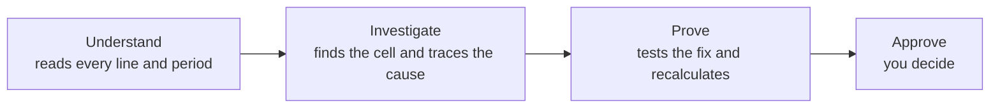

# Model X-Ray

The debugger for financial models. An AI agent powered by NVIDIA Nemotron that finds the errors hiding in Excel workbooks and proves every fix before a single cell changes.

- **Live demo:** <https://model-x-ray.vercel.app>
- **Devpost submission:**
- **Demo video (YouTube):**
- **Documentation:** [docs/](docs/), [API reference](docs/api.md), [Agent architecture](docs/agent-architecture.md)

<p align="center"></p>

## Try it

Open the [live demo](https://model-x-ray.vercel.app) and press **Try the demo**. It checks a European power purchase agreement model with 2,400 formulas and three planted errors, and stops for your approval before it writes anything. You can also upload your own `.xlsx`, up to 4.5 MB.

## Run it locally

You need Python 3.13 with [uv](https://docs.astral.sh/uv/), Node 20.19+ or [bun](https://bun.sh), and a Nebius Token Factory key.

```bash
git clone https://github.com/ol1ak5/model-x-ray.git
cd model-x-ray
uv sync
cp .env.example .env
```

In `.env`, set `NEBIUS_API_KEY` and `MODEL_X_RAY_MODELS_DIR=demo_models`, then start both servers:

```bash
scripts/dev.sh
```

Open <http://localhost:5173> and press **Try the demo**. The API reference is on <http://localhost:8000/docs>. `demo_models/` holds the two workbooks that ship with the repository. The rest of `.env.example` is optional: model overrides, file paths and cleanup, CORS, the public demo limits and LangSmith tracing. `GOOGLE_APPLICATION_CREDENTIALS` belongs to the Google Sheets sandbox, which no server path uses yet.

## Use it from the API

The web app is one client of a typed HTTP API. `POST /investigations` runs a check and returns the whole run, paused for your approval. `POST /investigations/{id}/resume` approves, edits or rejects the fix.

The public demo is for the browser. It calls the same API, but it has no key, one shared budget and a cap of five checks per visitor per day, with no uptime promise. Run the examples against your own copy.

```bash
curl -s -X POST localhost:8000/investigations \
  -H 'content-type: application/json' \
  -d '{"spreadsheet_id":"PPA_Model_Europe"}' | jq -r '.report'
```

Every route and payload is in [`docs/api.md`](docs/api.md). Drop the `jq` part to see the whole run.

## What it does

- **Seven error types:** typed values, wrong references, flipped signs, incomplete ranges, wrong periods, logic errors (a formula that contradicts its own label) and unusual inputs.
- **52 Excel functions**, cross-sheet references, defined names and circular references ([full list](docs/spreadsheet-core.md)).
- **Not supported yet:** links to other workbooks, Data Tables and VBA. When a check needs one of them, the agent names the cell and the formula and stops instead of guessing.

## Why it matters

A wrong cell moves real money and stays invisible. In 2012 a JPMorgan risk model divided by a sum instead of an average, and the "London Whale" trades lost $6.2 billion. In 1995 a missing minus sign turned Fidelity Magellan's $1.3 billion capital loss into a gain.

A real model has thousands of formulas across dozens of tabs. AI looks like the obvious reviewer, but a language model explains a number convincingly and still gets it wrong. Model X-Ray keeps the two jobs apart: **Nemotron reasons, the engine calculates.** Every claim is recalculated, and nothing changes without your approval.

## Architecture



Nemotron 3 Super maps the model, 3.5 Super judges every suspect and argues against each fix, and 3.5 Lightning writes the report and answers your questions. The ten nodes, the retry loop and the human-in-the-loop pause are in [`docs/agent-architecture.md`](docs/agent-architecture.md), with the full picture in [`docs/investigation-graph.png`](docs/investigation-graph.png).

## How we tested it

We built and tuned the agent on 217 workbooks: 26 Damodaran valuation models, 174 synthetic models with one planted error each plus clean and deliberate-value controls, and 17 logic test models in [`demo/`](demo). Every model carries a known correct answer, so each run is scored against it ([method](docs/evaluation.md)).

| Synthetic set, 12 variants per type | Rules only | Rules + Nemotron 3.5 Super |
|---|---|---|
| Typed number in place of a formula | 12 of 12 | **12 of 12** |
| Formula pointing to the wrong cell | 8 of 12 | **11 of 12** |
| SUM over the wrong range | 10 of 12 | **12 of 12** |
| Flipped sign | 11 of 12 | **12 of 12** |
| Formula pointing to the wrong period | 8 of 12 | **12 of 12** |
| Blended error (the symptom is not the cause) | 11 of 12 | **11 of 12** |
| Formula that contradicts its own label | 12 of 12 | **12 of 12** |
| **Planted errors fixed** | 72 of 84 (86%) | **82 of 84 (98%)** |
| False alarms on deliberate values | 12 of 12 ❌ | **0 of 12** ✅ |
| False alarms on clean models | 0 of 12 ✅ | **0 of 12** ✅ |

On five Damodaran models kept aside and never used for tuning, it fixed **18 of 20 planted errors (90%)**, pointed at **20 of 20**, and raised **no false alarm on the five clean originals**. A check on a model with an error takes a median of **65 seconds and 1.4 cents**.

## Built on NVIDIA Nemotron and Nebius Token Factory

| Model | Its job |
|---|---|
| **Nemotron 3.5 Super** | Investigator and Verifier: judges every suspect and tries to break every fix |
| **Nemotron 3 Super** | Mapper: labels every line and period of the workbook |
| **Nemotron 3.5 Lightning** | Writer: turns the evidence into a plain-language report and answers your questions |

All three are served on Nebius Token Factory through one OpenAI-compatible endpoint (`NEBIUS_BASE_URL`, by default `https://api.tokenfactory.nebius.com/v1/`) and one key.

## What Token Factory Accelerated

- **One endpoint, every model.** One key and one OpenAI-compatible API serve all three Nemotron models; LangGraph's client needed no adapter.
- **The right model for each step.** 3.5 Super reasons, 3 Super maps, 3.5 Lightning writes.
- **Upgrades in one line.** Moving the Investigator to Nemotron 3.5 Super was a config change: on an unseen SaaS model, fixed errors went from 0 of 5 to 4 of 5.
- **No new price.** 3.5 Super costs the same as 3 Super, $0.30 / $0.90 per million tokens.
- **Cheap and fast enough for a public demo.** About 1.4 cents and about a minute per error, with every suspect checked at the same time.

## Docs

| | |
|---|---|
| [Agent architecture](docs/agent-architecture.md) | the ten nodes, the models, the retry loop |
| [API](docs/api.md) | every route, the payloads, the limits |
| [Spreadsheet core](docs/spreadsheet-core.md) | the 52 functions, the parser, circular references |
| [Evaluation](docs/evaluation.md) | the workbooks, the scoring rules, the numbers |
| [Deployment](docs/deployment.md) | Vercel, the environment, the owner's steps |
| [Frontend](docs/frontend.md) | the two screens and the run kept in the browser |
| [Persistence](docs/persistence.md) | checkpointer, memory, what survives a reload |
| [Financial formulas](docs/financial-formulas.md) | the reference definitions the agent checks against |

## Development

```bash
uv run pytest           # 250 offline tests, no credits spent
uv run pytest -m live   # 26 live tests against Token Factory, spends credits
```

`scripts/serve.sh` runs the API alone, `scripts/export_graph.sh` refreshes the graph picture, and `scripts/screenshots.sh` renders the page at two sizes. The working contract for changes is in [`AGENTS.md`](AGENTS.md): branches, draft PRs, issue format and commit naming.

## Feedback on Token Factory and the NVIDIA models

- **What worked:** one endpoint for every model, OpenAI-compatible, with no adapter for LangGraph. Model IDs, context and prices come from `GET /v1/models`.
- **The one thing to know:** a reasoning model can spend its whole output budget on thinking. The structured conclusion is asked once more with thinking turned off, which keeps a check inside a browser request.
- **Failures arrive as 200s.** An overloaded or rejected call can answer HTTP 200 with `[ERROR: …]` in the body, so every answer is read and retried instead of trusted; overload (429, 5xx, 529) waits 5, 15 and 30 seconds before giving up.

## License

Copyright © 2026 Olga Aksenova and Guillermo Martín-Coello. Licensed under the [Apache License 2.0](LICENSE).

*Built for the Nebius x NVIDIA Global AI Hackathon 2026.*
