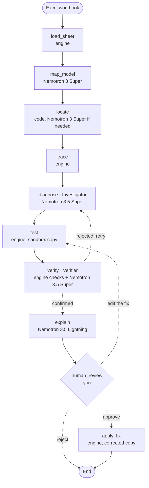

# Model X-Ray

<p align="center">
  
  
  
  
  
</p>

An AI agent powered by NVIDIA Nemotron that hunts down the errors hiding in Excel workbooks and proves every fix before a single cell changes.

<p align="center">
  <a href="https://model-x-ray.vercel.app"><b>Live demo</b></a>
</p>

## Try it Live

Open the live demo, press **Try the demo** and watch the agent check a European corporate PPA model (ten renewable offers, 2,400 formulas) with three planted errors, or upload your own `.xlsx` (up to 4.5 MB).


## The Problem

Financial models drive billion-dollar decisions, yet a single broken formula can distort an entire valuation without anyone noticing. In 2012, an error in JPMorgan’s Value-at-Risk model understated the bank’s risk exposure leading to the so-called “London Whale” scandal, that resulted in approximately $6Bn in trading losses for the bank.

Even if AI looks like the obvious reviewer for errors that escape from the human's eyes, LLMs struggle with numerical precision and nested logic, and can produce convincing explanations while getting the number wrong. Financial models don’t need plausible explanations. They need verifiable results.

## The Solution
Model X-Ray pairs NVIDIA Nemotron with a deterministic calculation engine, just as an experienced financial analyst combines expertise with reliable tools. Nemotron reasons through the model, interpreting formulas, distinguishing real errors from deliberate choices, and proposing fixes. The engine independently maps formula dependencies and recalculates values, grounding every conclusion in verifiable calculations rather than AI-generated numbers.

It is built for the people who sign off on a model before money moves: M&A and deal teams, investment bankers, corporate finance and FP&A analysts, and the reviewers who check their work.

## How it Works

The agent is a LangGraph state machine. Each step uses the NVIDIA Nemotron model that fits its job. The steps that compute use the engine and no model at all.


| Step | What it does |
|---|---|
| `load_sheet` | Opens the workbook and reads every formula |
| `map_model` | Labels every line and period (revenue, cost, ratio) |
| `locate` | Picks the cell to investigate; checks the whole model when there is no question |
| `trace` | Follows the dependency graph and measures what drives each change |
| `diagnose` | The Investigator. Rules propose suspects and the engine tests each fix on a copy; Nemotron judges whether each one is an error or a deliberate choice, and when none is, it reviews the model's logic line by line, three times, keeping what a majority finds |
| `test` | Applies the fix to a sandbox copy and recalculates |
| `verify` | Engine checks, then the Verifier tries to break the fix; the engine re-checks every objection. A rejected fix goes back to `diagnose` |
| `explain` | Writes the report in plain language, checked by code before it is shown |
| `human_review` | Shows the cell, the cause, the evidence and the numbers before and after, and waits for you |
| `apply_fix` | Writes the corrected copy; the original workbook never changes |

## Built on Nebius × NVIDIA

All LLM calls run on **Nebius Token Factory** (OpenAI-compatible) through LangChain's `ChatOpenAI`, using NVIDIA open-source **Nemotron** models:

| Model | Used for | Context | Price per 1M tokens (in / out) |
|---|---|---|---|
| `nvidia/Nemotron-3.5-Super-VL` | Investigator, Verifier | 1M | $0.30 / $0.90 |
| `nvidia/nemotron-3-super-120b-a12b` | Mapper, locate; benchmark comparison | 256K | $0.30 / $0.90 |
| `nvidia/Nemotron-3_5-Lightning` | Report writer | 1M | $0.06 / $0.24 |
| `nvidia/NVIDIA-Nemotron-3-Nano-30B-A3B` | Benchmark only: does a small model suffice? | 256K | $0.06 / $0.24 |

- **Nemotron 3.5 Super** is the Investigator and the Verifier: it judges every formula, reviews the model's logic and tries to break every fix.
- **Nemotron 3 Super** labels every line and period of the workbook.
- **Nemotron 3.5 Lightning** writes the final report.
- One Token Factory endpoint gave us all four models, so moving the reasoning steps to 3.5 Super was a one-line change, measured the same day.

| | Nemotron 3 Super | Nemotron 3.5 Super |
|---|---|---|
| GPQA Diamond, expert reasoning (NVIDIA) | 79.2 | **89.5** |
| τ²-bench airline, tool use (NVIDIA) | 56.3 | **76.5** |
| Unseen SaaS model, errors fixed (ours) | 0 of 5 | **4 of 5** |
| Price per 1M tokens (in / out) | $0.30 / $0.90 | $0.30 / $0.90 |

## How We Built and Tested It

The agent's checks, the formulas it compares against and the way it reads a model were built and tuned on three sets of workbooks, with part of the real models kept aside for the final score:

| Set | What it is | Errors |
|---|---|---|
| **Damodaran valuation models** | 26 public spreadsheets by Aswath Damodaran (NYU Stern): DCFs, cost of capital, capital budgeting; a median of 125 rows and 218 formulas | 95 planted (typed values, wrong references, flipped signs, period slips); 21 models for tuning, 5 held out |
| **Synthetic deal models** | A three-sheet deal model (assumptions, five-year P&L, summary) and 174 copies of it, each with one planted error, plus clean copies and copies with deliberate, documented values | 150 planted, 24 controls |
| **Logic test models** | A five-year budget and a SaaS subscription forecast the agent had never seen, in [`demo/`](demo) | 15 planted, including 7 logic errors where a formula contradicts its own label |

Every test model carries errors we planted ourselves, so each answer is scored against the truth (the right cell, the right cause, a fix that restores the original value), and clean models and deliberate values count as much as errors: "fixing" one is a false alarm. The same models are checked with Nemotron switched off and on, `scripts/benchmark.sh` reruns the benchmark, and the scoring rules are in [`docs/evaluation.md`](docs/evaluation.md).

## What Nemotron Adds

Measured on 21 and 22 Oct 2026 on the synthetic deal models (12 variants per error type plus 24 controls, one run each).

| Error type | Rules only | Rules + Nemotron 3.5 Super |
|---|---|---|
| Typed number in place of a formula | 12 of 12 | **12 of 12** |
| Formula pointing to the wrong cell | 8 of 12 | **11 of 12** |
| SUM over the wrong range | 10 of 12 | **12 of 12** |
| Flipped sign | 11 of 12 | **12 of 12** |
| Formula pointing to the wrong period | 8 of 12 | **12 of 12** |
| Blended error (the symptom is not the cause) | 11 of 12 | **11 of 12** |
| Formula that contradicts its own label | 12 of 12 | **12 of 12** |
| **Planted errors fixed** | 72 of 84 (86%) | **82 of 84 (98%)** |
| False alarms on deliberate values | 12 of 12 ❌ | **0 of 12** ✅ |
| False alarms on clean models | 0 of 12 ✅ | **0 of 12** ✅ |

## Tested on Models It Never Saw

Five of Aswath Damodaran's public valuation models were kept aside from the start and never used to tune the agent. On 27 Oct 2026 Nemotron 3.5 Super checked them with planted errors and in their original, clean versions:

| | Result |
|---|---|
| Planted errors found and fixed | **18 of 20 (90%)**: typed numbers 5 of 5, wrong periods 5 of 5, incomplete range 1 of 1, flipped signs 4 of 5, wrong references 3 of 4 |
| Planted errors the agent pointed at | **20 of 20** |
| False alarms on the clean originals | **0 of 5** |

## Cost and Time per Check

Every check below ran on Nebius Token Factory with the production set-up (Nemotron 3.5 Super, 3 Super and 3.5 Lightning):

| Model | Cost per check (median / max) | Time per check (median / max) |
|---|---|---|
| Damodaran model with an error | **1.4 cents** / 2.5 cents | **65 s** / 2 min 54 s |
| The PPA demo model (2,400 formulas) | **1.5 cents** | **85 s** |

A model with no error takes longer, up to about 4 minutes, because Nemotron reviews every line before calling it clean; a check never runs longer than that.

## Supported Excel functions

The engine calculates more than 50 Excel functions, among them `SUM`, `SUMPRODUCT`, `IF`, `IFERROR`, `INDEX`, `MATCH`, `VLOOKUP`, `XLOOKUP`, `OFFSET`, `SUMIFS`, `COUNTIFS`, `RANK`, `NPV`, `XNPV`, `IRR`, `XIRR` and `PMT`, plus cross-sheet references, defined names and circular references (solved iteratively). **Not supported:** links to other workbooks, Data Tables and VBA; each is reported by name on the cell that uses it, never guessed. The full list is in [`docs/spreadsheet-core.md`](docs/spreadsheet-core.md).

## Setup

```bash
uv sync                       # Python 3.13, installs the package
cp .env.example .env          # then fill in NEBIUS_API_KEY (a Nebius Token Factory key)
scripts/dev.sh                # the web app on http://localhost:5173 and the API on http://localhost:8000
```

`scripts/dev.sh` installs the frontend with bun (npm when bun is not installed) and stops both servers on Ctrl+C. Deploying the same app on Vercel takes the key and nothing else: [`docs/deployment.md`](docs/deployment.md).

## Tests

```bash
uv run pytest                 # offline, no credits: deep end-to-end tests
uv run pytest -m live         # live: calls Token Factory / Google APIs, spends credits
```

## Feedback on Token Factory and the NVIDIA models

**What worked well**

- One OpenAI-compatible endpoint and one key gave us four Nemotron models, so each step of the agent uses the model that fits it.
- Switching the reasoning steps from Nemotron 3 Super to 3.5 Super was a one-line change: fixed errors on an unseen model went from 0 of 5 to 4 of 5, at the same price.
- With Nemotron, the agent fixed 98% of planted errors against 86% for rules alone, with no false alarm on deliberate values (rules alone broke 12 of 12).
- A check of a model with an error costs about 1.4 cents and takes about a minute (medians on models the agent never saw).

**What would help**

- **"System is overloaded" during peak hours:** some calls ended with HTTP 529 even after retries; we now wait 5, 15 and 30 seconds before giving up. A `Retry-After` header would let clients wait exactly as long as needed.
- **Errors returned as answers:** long calls sometimes came back as HTTP 200 with `[ERROR: Agent failed ... timed out after 90 seconds]` as the reply. A non-200 status would let clients retry safely.
- **Reasoning that never reaches the tool call:** Nemotron 3.5 Super sometimes used its whole output budget reasoning and returned no tool call. We now ask once more with `chat_template_kwargs.enable_thinking=false`, which answers at once with no reasoning tokens; a per-request way to cap reasoning, rather than switch it off, would help.
- **Model metadata in the API:** prices, context windows and output limits are only in the web catalogue, not in `GET /v1/models`.
- **New models announced in the API:** a changelog or deprecation field would help teams notice new models like Nemotron 3.5 Super.

## Links

- Devpost submission: <https://nebiusglobalaihackathon.devpost.com/>
- Architecture and design: [`docs/agent-architecture.md`](docs/agent-architecture.md)
- Roadmap: [GitHub issues](https://github.com/ol1ak5/model-x-ray/issues)

## License

Copyright © 2026 Olga Aksenova and Guillermo Martín-Coello.

Licensed under the Apache License 2.0; see [LICENSE](LICENSE).
