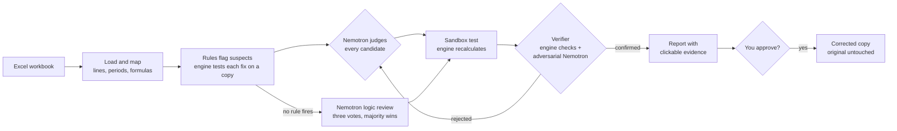

# Model X-Ray

An AI agent built for financial model auditing, powered by NVIDIA Nemotron, that uncovers hidden errors, reasons through financial logic, and verifies every proposed fix through independent workbook recalculation. Every correction is evidence-based, and no changes are made without the user’s approval.

## Try it Live


## The Problem

Financial models drive billion-dollar decisions, yet a single broken formula can distort an entire valuation without anyone noticing. In 2012, an error in JPMorgan’s Value-at-Risk model understated the bank’s risk exposure leading to the so-called “London Whale” scandal, that resulted in approximately $6Bn in trading losses for the bank.

Even if AI looks like the obvious reviewer for errors that escape from the human's eyes, LLMs struggle with numerical precision and nested logic, and can produce convincing explanations while getting the number wrong. Financial models don’t need plausible explanations. They need verifiable results.

## The Solution
Model X-Ray that pairs NVIDIA Nemotron with a deterministic calculation engine, just as an experienced financial analyst combines expertise with reliable tools. Nemotron reasons through the model, interpreting formulas, distinguishing real errors from deliberate choices, and proposing fixes. The engine independently maps formula dependencies and recalculates values, grounding every conclusion in verifiable calculations rather than AI-generated numbers.

## Setup

```bash
uv sync                       # Python 3.13, installs the package
cp .env.example .env          # then fill in NEBIUS_API_KEY
uv run model-x-ray            # smoke check: prints the banner
```

## Tests

```bash
uv run pytest                 # offline, no credits: deep end-to-end tests
uv run pytest -m live         # live: calls Token Factory / Google APIs, spends credits
```

## How it Works



1. **Map.** The engine reads every sheet, labels each line and period, and builds the dependency graph of every formula.
2. **Flag.** Pattern rules propose suspects (typed numbers, flipped signs, broken ranges, wrong periods), and the engine tests each candidate fix on a copy.
3. **Judge.** Agent reads each candidate the way a senior analyst would and decides whether it is an error or a deliberate choice. When no rule fires, it reviews the model's logic line by line in plain words, three times, and keeps what a majority finds.
4. **Verify.** The engine recalculates the patched copy, and a second Nemotron tries to break the fix; the engine re-checks every objection.
5. **Approve.** You see the cell, the cause, the evidence and the numbers before and after. An approved fix is written to a corrected copy; the original workbook never changes.

## Built on Nebius × NVIDIA

All LLM calls run on **Nebius Token Factory** (OpenAI-compatible) through LangChain's `ChatOpenAI`, using NVIDIA open-source **Nemotron** models:

| Role | Model |
|---|---|
| Investigator, Verifier | `nvidia/Nemotron-3.5-Super-VL` (1M context, $0.30 / $0.90 per 1M tokens) |
| Model mapper, locate | `nvidia/nemotron-3-super-120b-a12b` (256K context, $0.30 / $0.90) |
| Report writer (`explain`) | `nvidia/Nemotron-3_5-Lightning` (1M context, $0.06 / $0.24) |
| Benchmark comparison set-up `super-3` | `nvidia/nemotron-3-super-120b-a12b` |
| Benchmark small-model set-up | `nvidia/NVIDIA-Nemotron-3-Nano-30B-A3B` ($0.06 / $0.24) |
| Benchmark hardest-verification set-up | `nvidia/Nemotron-3-Ultra-550b-a55b` (1M context, $1.00 / $3.00) |

## Supported Excel functions

| Family | Functions |
|---|---|
| Maths | `SUM` `AVERAGE` `MIN` `MAX` `ROUND` `ROUNDDOWN` `INT` `MOD` `POWER` `ABS` `EXP` `LN` `SUMPRODUCT` `LARGE` `SMALL` |
| Logic and information | `IF` `IFERROR` `AND` `OR` `NOT` `CHOOSE` `ISERROR` `ISNUMBER` `ISTEXT` `ISBLANK` |
| Counting and conditional | `COUNT` `COUNTA` `SUMIF` `SUMIFS` `COUNTIF` `COUNTIFS` |
| Lookups and references | `INDEX` `MATCH` `VLOOKUP` `HLOOKUP` `XLOOKUP` `OFFSET` |
| Dates | `EOMONTH` `EDATE` `YEAR` `MONTH` `DAY` `DATE` |
| Valuation, debt, statistics | `NPV` `XNPV` `IRR` `XIRR` `PMT` `PPMT` `NORMSDIST` |
| Also | Cross-sheet references, ranges, whole rows and columns, defined names; circular references solved iteratively, like Excel, when the file has iteration on |
| Not supported | Links to other workbooks, Data Tables, VBA |

Full spec: [`docs/spreadsheet-core.md`](docs/spreadsheet-core.md).

### The Models We Built It On

Model X-Ray was developed and tuned on three sets of workbooks, keeping part of the real models aside for the final score:

| Set | What it is | Errors |
|---|---|---|
| **Damodaran valuation models** | 26 public spreadsheets by Aswath Damodaran (NYU Stern): DCFs, cost of capital, capital budgeting; a median of 125 rows and 218 formulas | 95 planted (typed values, wrong references, flipped signs, period slips); 21 models for tuning, 5 held out |
| **Synthetic deal models** | A three-sheet deal model (assumptions, five-year P&L, summary) and 174 copies of it, each with one planted error, plus clean copies and copies with deliberate, documented values | 150 planted, 24 controls |
| **Logic test models** | A five-year budget and a SaaS subscription forecast the agent had never seen, in [`demo/`](demo) | 15 planted, including 7 logic errors where a formula contradicts its own label |

## What Nemotron Adds

Measured on the synthetic deal models (12 variants per error type plus 24 controls, one run each).

| Error type | Rules only | Rules + Nemotron 3.5 Super |
|---|---|---|
| Typed number in place of a formula | 12 of 12 | **12 of 12** |
| Formula pointing to the wrong cell | 8 of 12 | **11 of 12** |
| SUM over the wrong range | 10 of 12 | **12 of 12** |
| Flipped sign | 11 of 12 | **12 of 12** |
| Formula pointing to the wrong period | 8 of 12 | **12 of 12** |
| Blended error (the symptom is not the cause) | 11 of 12 | **11 of 12** |
| **Planted errors fixed** | 72 of 84 (86%) | **82 of 84 (98%)** |
| False alarms on deliberate values | 12 of 12 | **0 of 12** |
| False alarms on clean models | 0 of 12 | **0 of 12** |

## Why these Nemotron models

The agent never asks a model to calculate: the Excel engine produces every number. What the model must do is judge a formula the way an expert analyst would and drive tools over several steps. So we chose by the benchmarks that measure those two skills, then checked the choice on our own task.

| Skill the agent needs | Benchmark (NVIDIA model cards) | Nemotron 3 Super | Nemotron 3.5 Super |
|---|---|---|---|
| Expert reasoning: is this formula right? | GPQA Diamond | 79.2 | **89.5** |
| Hard expert questions | HLE, text only, no tools | 18.3 | **31.8** |
| Multi-step tool use | τ²-bench retail / airline / telecom | 62.8 / 56.3 / 64.4 | **69.2 / 76.5 / 73.2** |
| Following instructions and formats | IFBench | **72.6** | 70.9 |

Both cost the same on Token Factory ($0.30 / $0.90 per 1M tokens), and 3.5 Super reads four times more context (1M tokens). The decisive test was ours: a five-year SaaS subscription forecast the agent had never seen, with five planted logic errors (churned customers added instead of subtracted, a contribution margin that skips support costs, revenue on 10 months a year, a margin divided by costs instead of revenue, a price typed 100 times too large) and a clean copy.

| On the unseen SaaS forecast | Nemotron 3 Super | Nemotron 3.5 Super |
|---|---|---|
| Errors fixed and verified | 0 of 5 | **4 of 5** |
| Errors seen | 1 of 5 | **5 of 5** (the price typo is flagged for a person, never fixed with an invented value) |
| False alarms on the clean copy | 0 | 0 |
| Tokens for the whole set | 307,000 | 442,000 |

Nemotron 3 Super read "Closing customers = Opening customers + New customers + Churned customers" and answered that every line matched its label; 3.5 Super caught it in all three votes and fixed the whole line. It spends more tokens only because it goes on to test, verify and correct what it finds; on a clean file both spend about the same. The Investigator and the Verifier run on 3.5 Super; 3 Super stays available as the `super-3` benchmark set-up.

The mapper (the one call that labels every line and period of a sheet) and `locate` stay on 3 Super, for a measured reason. 3.5 Super passes every tool-calling check (40 of 40, with a faster slowest call than 3 Super), but as the mapper of a real 436-line Damodaran DCF it spent its whole 8,192-token output reasoning and never returned the map, the failure Lightning showed before: on a real 63-line project-finance model Lightning wrote its reasoning as text and hit the same limit without calling the tool, while Nemotron 3 Super returned all 63 lines and 24 periods in 7 seconds (about 1,900 output tokens, 0.3 cents), cached per file revision (PR #97). A failed map never stops an investigation.

The report writer is the exception. `explain` is the last step, has no tools and no structured output, and Super spent about 9 s and 2,000 output tokens on a three-to-six-sentence report, the largest wait left after the Investigator; it runs on Lightning with a 1,400-token cap. The narrative is checked against the brief before it is shown (plain prose, the patched cell named, only evidence ids that exist), and the deterministic report is used when that check fails, so a faster writer can never lose a citation.

## How we evaluate it

The proof of value is planted errors: the generated models carry 75 known mistakes (hardcoded numbers where the row uses formulas, broken references, sign flips, range errors, period slips), and the Enron Errors Corpus adds real spreadsheets with known corrections. Every diagnosis is scored against the known answer (cell, cause and fix) per step, through four set-ups that differ only in configuration: rules alone, Nano with the tools, Super with the tools (what the app runs), and Super with the whole sheet pasted as text and no tools.

174 variants, 696 investigations, run on 21 Oct 2026 with Nemotron 3 Super, before the Investigator and the Verifier moved to Nemotron 3.5 Super and before the logic review of #181; 31 failed with errors and are excluded:

| Set-up | Root cause top-1 | Fix accuracy | False alarms | Latency p50 | Cost / investigation |
|---|---|---|---|---|---|
| rules only | 22% | 0% | 100% | 0.0 s | $0.0000 |
| Nano + tools | 82% | 81% | 7% | 97 s | $0.0072 |
| Super + tools (the app) | 75% | 74% | 4% | 20 s | $0.0123 |
| Super, sheet in the prompt, no tools | 92% | 92% | 25% | 15 s | $0.0068 |

The tools are not what finds the cell on a 63-line model: a strong model with the whole sheet in its prompt does better on planted errors. It is also wrong about models that are fine: it invents a root cause in one of four healthy or deliberately hardcoded models, where the tool loop leaves them alone. The tools are also the only thing that scales to a workbook the context window cannot hold, and what produces the clickable evidence. The gap is measured and open in #179, not smoothed over. The per-type table, the per-step metrics (locate, trace, verdict) and the confusion matrix are in the generated report, `docs/benchmark.md`, which `scripts/benchmark.sh` writes together with the raw `docs/benchmark-results.json` and the chart (`--render-only` re-renders; none of the three is committed). Metrics and scoring rules: [`docs/evaluation.md`](docs/evaluation.md). The held-out splits are frozen in `docs/damodaran-split.json` and `docs/enron-split.json`.

## Links

- Devpost submission: <https://nebiusglobalaihackathon.devpost.com/>
- Architecture and design: [`docs/agent-architecture.md`](docs/agent-architecture.md)
- Roadmap: [GitHub issues](https://github.com/ol1ak5/model-x-ray/issues)

## License

Apache 2.0 – see [LICENSE](LICENSE).
