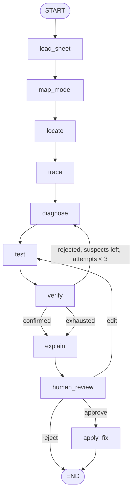

# Agent architecture

Model X-Ray is an evidence-first Nemotron agent that investigates surprising outputs in financial models. Given a question such as "Why did 2027 EBITDA jump 30%?", it locates the cell, traces its inputs, diagnoses the root cause, tests a fix in a sandbox copy, verifies the result, explains it with clickable evidence, and returns a corrected copy after a human approves.

Roadmap: #2. This document: #3.

## Design principles

1. **Nemotron judges, code computes.** Every number comes from deterministic code or from the spreadsheet's own recalculation. The LLM never does arithmetic and may only quote tool results.
2. **Evidence first.** Every claim in the final answer points to a cell, the expected pattern, and a verified before/after value.
3. **Prove the fix.** A diagnosis counts only after the patched sandbox copy recalculates to a result that resolves the anomaly and stays consistent with the model.
4. **The original is never written.** The LLM has no write tool. Only the `apply_fix` node writes, only after human approval, and only to a new corrected copy.
5. **Honest failure.** If no hypothesis survives verification, the agent says the result is inconclusive instead of guessing.

## Platform

Spreadsheets are read through a `SpreadsheetSource` interface and tested through a `Sandbox` interface.

| Adapter | Status | Read | Recalculate |
|---|---|---|---|
| `.xlsx` | Working, what ships | `XlsxSource` over `openpyxl` | `spreadsheet/engine.py`: our own Excel-compatible engine (dependency graph, iterative calculation for circular references, `OFFSET`, Excel error semantics) |
| Google Sheets | Sandbox adapter only (#13) | Not implemented: there is no Google `SpreadsheetSource` yet | `GoogleSandbox` copies the file with Drive `files.copy`, writes the patch and reads the values Google recalculated; no server path uses it and its tests run against fake services |

The plan was Google Sheets first, because its sandbox is exact: the recalculated numbers are the ones the user would see. The `.xlsx` engine became exact enough to carry the demo instead — it needs no credentials, it handles the circular references and `OFFSET` real models contain, and a judge can upload a file with nothing to install — so `.xlsx` is the platform that ships and Google is an adapter waiting to be wired.

Scope for the hackathon: standard models without scripts or macros. Named ranges, `INDIRECT` and `OFFSET` are out of scope unless the demo model needs them.

## Graph



| Node | Kind | What it does | Writes to state |
|---|---|---|---|
| `load_sheet` | Code | The workbook is loaded once through the `SpreadsheetSource` (an unknown id or a missing file raises a clear `ValueError`); the node stops the run when no cell has both a line label and a period header | (workbook cached outside state) |
| `map_model` | Nemotron Super | Labels every line (`revenue`, `cost`, `subtotal`, `ratio`, `other`) and every period (`actual`, `forecast`); see Model map below | `model_map` |
| `locate` | Code first, Nemotron Super when needed, then `find_cells` | Turns the question into a target cell and its prior-period cell (see Locate below); when several cells match it picks one itself, and when none does it checks the whole model instead; either way the choice is recorded for the report | `target`, `target_choice` |
| `trace` | Code | Precedents of the target, the contribution of each input to the change, and the causal tree built from them; writes one evidence record per observation (the target anomaly, then each contribution, `anomaly` or `expected_pattern` by the tree's suspicious flag) | `contributions`, `causal_tree`, `evidence` |
| `diagnose` | Investigator agent (subgraph) | Hypothesis-driven loop over read-only tools (see below), returns ranked hypotheses with evidence and a minimal patch | `hypotheses`, `evidence`, `patch` |
| `test` | Code | Copies the sheet, applies the patch, reads recalculated values | `verifications` (values part) |
| `verify` | Code checks + Verifier agent | Deterministic checks, then an independent attempt to disprove the diagnosis; a `confirmed` verdict also writes a `verification` evidence record with the target's sandbox before and after (e.g. `P&L!H8 52.01 -> 44.73 in a sandbox copy after patching P&L!H7`), which `explain` cites as the proof of the fix | `verifications`, `hypotheses`, `evidence`, `attempts` |
| `explain` | Code, or the narrative model when one is wired | Evidence-linked report, every cited evidence id resolves in state. Three outcomes: a confirmed root cause ("Root cause found in ..."); "No error found. <line> moved from A to B (ev); the change comes from <up to three largest drivers with cell, change and evidence>" when the Investigator proposed no hypothesis at all (a clean model, or only cells a reviewer marked intentional); "No confirmed error. <line> moved from A to B (ev); the change comes from <drivers>. The agent checked N suspects but could not prove any of them: <cell> (<error type>), because <reason>; ... Nothing was changed; review these cells before relying on the number." when hypotheses were proposed but none survived verification. The reason is plain English: the failed code checks ("the fix did not remove the unusual change", "the fix broke cells that depend on it", "the fix did not match the formulas next to it"), the Verifier's own reason, or "it was not tested before the agent's 3 attempts ran out". A cell suspected twice is reported with its tested attempt. On the confirmed path with a model wired (`run_investigation(explainer=...)`), the narrative model writes the report from a brief built only from the question, target numbers, hypothesis, patch, verification checks and the citable evidence records (id, cell, kind, text); code validates the answer and falls back to the deterministic report when any `ev-` id is unknown or the answer cites nothing. The other two outcomes and the benchmark's runner never call a model for `explain` | `report`, `run_log` |
| `human_review` | Interrupt | Approve, edit the fix, or reject with a reason; an `edit` replaces `patch` with the human's (marked `source: human`) and reopens the last-verified hypothesis so the sandbox re-proves it | `human_decision`, `patch`, `hypotheses` |
| `apply_fix` | Code | Writes a corrected copy with a `Change log` tab | `corrected_copy_id` |

### Building the graph

`build_graph(checkpointer, diagnose, overrides=None)` takes the `diagnose` node as an explicit argument — there is no default, because a default would risk running a stub that fabricates findings. The production entrypoint is `run_investigation(llm, spreadsheet_id, source, sandbox, checkpointer=None, verifier=None, locator=None, mapper=None, explainer=None)`: it loads the `Workbook` through the `SpreadsheetSource`, builds the real read-only tools from it (`make_read_only_tools(book)`), wires the Investigator as `diagnose`, and as overrides the real `trace` (`nodes.make_trace_node(book)`), the real `test` (`nodes.make_test_node(source, sandbox)`, which runs `run_sandbox_test` and writes the before/after values part of the verification record), the real `verify` (`nodes.make_verify_node(verifier or llm, source)`, which computes the deterministic checks and consults the Verifier agent), the real `explain` (`nodes.make_explain_node(explainer)`, which on the confirmed path lets the narrative model write the report from a validated brief — every cited id must resolve in state, otherwise the deterministic report is used — and reports an inconclusive run without citing anything), and the real `apply_fix` (`nodes.make_apply_fix_node(sandbox)`, which writes the corrected copy with its `Change log` tab only on the approve route), then returns the compiled graph; the caller invokes it and handles the `human_review` interrupt. The `verifier` parameter defaults to `llm` (the Verifier is the same model with a different prompt); `explainer` defaults to no model, so a confirmed report stays deterministic unless the caller wires one (the demo server wires `build_chat_model(role="explain")`); tests pass a scripted model so the roles are independent. Tests that exercise graph mechanics pass the stub by name (`diagnose=nodes.stub_diagnose`, default stub `trace`/`test`/`verify`/`explain`/`apply_fix`).

### Routing after `verify`

| Condition | Next node |
|---|---|
| Latest verification is `confirmed` | `explain` |
| `rejected`, untested hypotheses remain, and `attempts < 3` | `diagnose` (with rejected hypotheses in context) |
| Otherwise | `explain`, marked inconclusive |

### Routing after `human_review`

| Decision | Next node | Side effect |
|---|---|---|
| `approve` | `apply_fix` | Finding stored in long-term memory |
| `edit` | `test` | The human's patch replaces the agent's (marked `source: human`), and the last-verified hypothesis reopens so `test`/`verify` re-prove the edited patch |
| `reject` | `END` | If the reason is "intentional", an override is stored in long-term memory |

## Model map

Implementation: `src/model_x_ray/agents/mapper.py`, prompt `prompts/map_model.md`, wired by `run_investigation` when a `mapper` model is passed (the API passes the `mapper` role, Super; without one the map stays empty and every other step still works).

1. **Brief.** The mapper sees the periods and one line per catalogue label: the formula of the line's right-most cell (or "typed number") and the labels of the lines it uses, e.g. `EBITDA: =H6+H7; uses Gross profit, Opex`. Formulas plus the names they use are what an analyst reads to tell a subtotal from a cost.
2. **One structured call.** `with_structured_output(ModelMapAnswer, method="function_calling")` returns a kind per line and per period.
3. **Only real names.** Lines and periods that are not in the catalogue are dropped, as in locate.
4. **Readers.** `locate` adds the actual and forecast periods to its brief, so "next year" resolves even when periods carry no A/E suffix; `investigation_brief` adds the line kinds and period kinds, so the Investigator knows which cells are subtotals and which are forecasts.

Follow-up: cache the map per sheet revision in long-term memory (#11).

## Locate

Implementation: `src/model_x_ray/agents/locator.py`, prompt `prompts/locate.md`, wired by `run_investigation` (optional `locator` model, defaulting to the main model).

1. **Catalogue.** From the workbook, collect the sheets, the line labels (row labels of cells that have a period header) and the periods (column headers).
2. **Cheap path, no LLM.** If exactly one catalogue line and exactly one period (by year) appear in the question, use them directly; a sheet named in the question narrows the search. Most questions ("Why did EBITDA jump in 2027?") never call a model.
3. **Nemotron path.** Otherwise Nemotron receives the question plus the catalogue and returns a `LocateRequest` (`label`, `period`, optional `sheet`) chosen only from the catalogue. The prompt maps analyst wording to lines ("operating profit before D&A" is EBITDA) and fixes relative periods: periods ending in A are actuals, E are estimates; "this year" is the first estimate period, "next year" the one after, "last year" the latest actual.
4. **Lookup in code.** `find_cells(label, period)` returns the real cells. One match becomes the target; its prior cell is the nearest cell to the left in the same row that has a period header. Several matches never pause the agent: `pick_target` keeps the cells that have a prior period, drops the ones that only link to another candidate (`Summary!D10 = P&L!H8` leaves `P&L!H8`), and takes the one with the most inputs, then the earlier sheet. No match falls back to check mode on the whole model. Both write `target_choice` (the candidates, the chosen cell and one sentence of why), and the report opens with that sentence, so the reviewer sees the choice at the only pause and can reject it.

Nemotron never writes a cell address: it can only pick names that exist, and code turns them into cells.

### Table rules (check mode without a timeline)

When no question is asked and no row breaks its period pattern, `rules.scan_tables` looks for table-shaped errors. Each finding carries a `kind`, a plain-English `reason` and the `fix` formula the engine tests on a copy:

| Kind | What it catches | Fix |
|---|---|---|
| `incomplete_total` | A SUM over part of the contiguous block of numbers above it (at most two blank rows between) | A SUM over the whole block |
| `incomplete_total` (section) | A subtotal whose line label contains "total" and whose SUM leaves out numbers in its section: the cells between the subtotal and the header or previous total above it, blank rows included. Enron's hot lists put a single deal under a header, several blank rows, then `=SUM(M21)` | A SUM from the section's first number to the row above the subtotal |
| `double_count` | A total that adds a subtotal and also that subtotal's parts | The parts without the subtotal |
| `typed_in_column`, `column_pattern` | A typed value or a different reference pattern in a column of copied formulas; only inside table-like blocks (tables, or periods running down) | The column's formula copied into the cell |
| `aggregate_range` | A SUM, AVERAGE, MIN, MAX, COUNT or COUNTA whose range disagrees with the same function in the cells beside it (along the row or the column, at most two blank cells between) | The range its neighbours use, on the axis where it differs |

`aggregate_range` follows ExceLint's rule that a total is compared only with neighbouring totals, never with its own inputs (`docs/research/related-work.md`). For each axis (rows, columns) the neighbours' range offsets, relative to their own cell, must agree in a strict majority, and the cell's offsets must match none of them. A finding needs exactly one differing axis; on the other axis the cell must agree with the majority, or, when the neighbours step through blocks (`AVERAGE(H50:H56)`, `AVERAGE(H57:H63)`, ...), have the same range length. So `=SUM(D38)` in a row of `=SUM(C12:C38)` totals and `=AVERAGE(F64:H70)` in a column of single-column averages are findings, while a grand total `=SUM(B42:E42)` at the end of a totals row (both axes differ) and running totals `=SUM($F$12:F12)` (no majority) are not.

## Agents

Three steps need judgment, so three agents. Everything else is a plain Python node.

| Agent | Model | Tools | Job |
|---|---|---|---|
| Investigator | Nemotron 3 Super | Read-only only | Hypothesis-driven loop inside a subgraph with its own private messages. Decides what to investigate next, tells real errors from deliberate overrides, ranks hypotheses, proposes a minimal patch |
| Verifier | Nemotron 3 Super, adversarial prompt | None (receives a fixed evidence package) | Assumes the diagnosis is wrong and looks for evidence that invalidates it. Never sees the Investigator's reasoning. A rejection must list its claims (`formula`, `value`, `note`), and the engine checks each one before the verdict counts (see Verifier claims below) |
| Model mapper | Nemotron Super | None | One structured-output call per sheet revision to build the semantic map |

Model assignment is provisional until the tool-calling spike (#4) reports results. A separate "hypothesis planner" agent is deliberately not added: planning stays inside the Investigator unless the benchmark shows that splitting it improves accuracy.

The system presents itself as one reasoning loop with three capabilities: **understand** (Model mapper), **investigate** (Investigator), **verify** (Verifier), followed by **explain**.

### Logic review (when no rule flags a cell)

Pattern rules cannot see a formula that is wrong in every period (a gross profit that adds its costs, an EBITDA that subtracts only salaries, a net income that never subtracts taxes): the line is consistent, so nothing breaks. When the rules give the Investigator no candidate, its brief also carries the logic review (`prompts/logic_review.md`) and a logic map built in code (`logic_map` in `agents/investigator.py`):

- every line feeding the reviewed result, plus every formula line on its sheet, written as its label and its formula with each reference replaced by the label of the line it reads (`Gross profit = Revenue + Cost of goods sold`), once per formula pattern, with the period span it covers, the values in the reviewed period and, when the label names a concept in the financial formula library (`finance.py`, matched by whole words, the last word deciding), the standard definition;
- the total column collapsed into one line, and the lines that are calculated but used by no other line (an EBITDA that skips the cost total leaves that total unused);
- suspicious inputs: typed values five times larger or smaller than the same input in the other periods (`rules.input_outliers`).

The system prompt (`prompts/investigator.md`) makes the Investigator a senior analyst who always starts from the formula, compares it with the label and the standard definition, respects the model's sign convention and only then checks consistency. Two error types join the five pattern types: `logic_error` and `input_outlier`.

In check mode (no question) the logic review runs three times and keeps what a majority finds: a cell survives when at least two answers name it, with the most voted error type and the fix a majority proposes. Nemotron Super at temperature 0 still varies between runs, and the vote removes one-off findings and one-off misses. The decision records the counts (`votes`) and every answer (`ballots`). Runs with a question, and runs where rules gave candidates, make one call.

A `logic_error` whose cell shares its formula with the rest of its line is fixed on the whole line: `Patch.also` lists the other cells with the same fix shifted to each column. The sandbox, the corrected copy and the Google copy apply all of them, and the deterministic checks become: the cell's value changes, every dependent still calculates, the line ends with one pattern. The Verifier receives the anomaly kind `line logic error` with the line's formula in words before and after and its standard definition, and judges the new formula against them instead of the move against the prior period. Other error types keep single-cell fixes, so a wrong fix on a correct line cannot pass by making the line uniform. An `input_outlier` or a `logic_error` without a fix closes as a finding for a person (the report quotes the claim) instead of being retried.

`uv run tools/trace_run.py <model.xlsx> [--setup super]` prints one run's target, logic brief, every vote, every decision, every verification and the report.

### Investigator loop

The Investigator is the most autonomous part of the system, and its autonomy must be visible, not hidden inside one call.

```
OBSERVE        read the causal tree and contributions from trace
HYPOTHESIZE    list candidate causes (at most 3 open at a time)
SELECT TOOL    choose the read-only tool that best separates the candidates
OBSERVE        read the tool result
UPDATE         raise, lower or reject hypotheses, citing evidence ids
   ... repeat SELECT TOOL to UPDATE ...
PROPOSE        top hypothesis + minimal patch
```

| Budget | Limit | Why |
|---|---|---|
| Tool calls per diagnose run | 8 | Autonomy with a predictable cost and latency |
| Open hypotheses | 3 | Forces ranking instead of listing everything |
| Diagnose-verify attempts | 3 | Bounded retry loop |

Budgets are enforced in code, not trusted from the model: a batch of parallel tool calls is truncated at the remaining budget and the overflow calls get a `Tool budget exhausted.` tool message instead of executing, so `tool_calls_used` never exceeds the limit; each diagnosis is cut to the remaining open-hypothesis budget — at most 3 open at a time, counting the ones a retry still carries — in model order before entering state, and the brief states the live `Open hypotheses: n/3` count so the model can rank against it.

The exact text of the proposed formula is not trusted either. When the patch lands on a cell that is a typed value or that breaks its row's pattern, `row_formula_suggestion` replaces the model's formula with the one the row's majority pattern produces for that cell (`shifted_formula` from the nearest agreeing neighbour). The rule only takes a formula derived from the model itself, and only when the row's formulas agree on one pattern; with a tie it leaves the model's text alone. It is the same property the Verifier's `pattern_restored` check demands, so a good diagnosis is no longer lost to a formula the model wrote by hand — on the served demo model a patch proposed as `=G4*1.05` for `P&L!G5` becomes `=-G4*Assumptions!$C$5` and passes.

### Confidence levels

The Investigator ranks hypotheses with a categorical confidence instead of a number, because an LLM cannot meaningfully tell 0.83 from 0.85. Each level is tied to evidence the tools can show:

| Level | Evidence required |
|---|---|
| `high` | The cell breaks the pattern of its neighbours (`compare_formulas`), it explains a meaningful part of the change (`explain_change`), and nothing shows a deliberate override (`get_cell_metadata`) |
| `medium` | The cell breaks the pattern, but either its impact on the change is not established or a deliberate override cannot be ruled out |
| `low` | There is an inconsistency, but no pattern break has been established |

Confidence only ranks suspects before testing; the sandbox and the Verifier decide. A patch is proposed only for the top hypothesis, and only when the neighbouring formulas support a corrected formula. The rules live in the product prompt `src/model_x_ray/prompts/investigator_conclude.md`. One rule is enforced in code, not left to the model: when the patched cell holds a typed value and all formula neighbours in its row share one pattern, `diagnose` replaces the proposed formula with that neighbour's formula shifted to the cell (`Workbook.shifted_formula`), and `compare_formulas` shows the same suggestion to the Investigator as a tool result, so claim and patch agree; the Investigator's own formula survives only when the row offers no consistent pattern.

Every UPDATE writes to `hypotheses` in the state, so the interface can show a live hypothesis board: candidates appearing, gaining or losing confidence, and being rejected, each linked to the evidence that moved it. When the budget runs out, the Investigator must propose its best hypothesis or declare the case inconclusive.

### Verifier: adversarial second opinion

The two prompts are deliberately incompatible. The Investigator is told to find the most likely explanation and construct a minimal fix (`src/model_x_ray/prompts/investigator.md`); the Verifier is told to assume the diagnosis is wrong and find any evidence that invalidates it (`src/model_x_ray/prompts/verifier.md`). The Verifier call sends the prompt as the system message and the evidence package as JSON in the human message, through one structured-output call.

| The Verifier receives | The Verifier does not receive |
|---|---|
| Original question and target | The Investigator's messages or reasoning |
| The proposed patch | Rejected hypotheses |
| Relevant formulas (patched cell, its neighbours, its dependents) | |
| Sandbox before/after values and the deterministic check results | |

It returns `confirmed` or `rejected` with reasons. Deterministic checks run first, computed in code from the sandbox values and the engine: `anomaly_resolved` (the target moved from its surprising value toward the prior-period value without inverting), `dependents_consistent` (every dependent's sandbox value equals what the model's own formulas recalculate to, with no gaps), and `pattern_restored` (the patched cell's formula pattern matches a formula neighbour in its row; vacuously true when the row has no formula neighbour). The Verifier can reject a patch that passes all of them, but a failed check forces `rejected` without consulting the Verifier at all.

## State

The graph routes on structured fields and the evidence view displays them, so state is not messages only. Each key has a deliberate reducer: no annotation means the new value overwrites the old one.

```python
class InvestigationState(TypedDict):
    messages: Annotated[list[AnyMessage], add_messages]
    spreadsheet_id: str
    question: str
    model_map: ModelMap | None
    target: TargetCell | None
    contributions: list[Contribution]
    causal_tree: CausalNode | None
    hypotheses: Annotated[list[Hypothesis], merge_by_id]
    patch: Patch | None
    verifications: Annotated[list[Verification], merge_verifications]
    evidence: Annotated[list[Evidence], operator.add]
    run_log: Annotated[list[RunLog], operator.add]
    attempts: int
    report: str | None
    human_decision: HumanDecision | None
    corrected_copy_id: str | None
```

| Key | Reducer | Why |
|---|---|---|
| `messages` | `add_messages` | Conversation with the user only; appends, and replaces by message id |
| `target`, `patch`, `report`, `human_decision`, `corrected_copy_id` | Overwrite | One current value |
| `contributions`, `causal_tree` | Overwrite | Recomputed as a whole by `trace` |
| `hypotheses` | `merge_by_id` (custom) | The Verifier updates a hypothesis status in place; new ids append; never duplicates |
| `verifications` | `merge_verifications` (custom) | `test` writes the before/after values part and `verify` completes the same record with checks and verdict: one record per hypothesis, merged by `hypothesis_id` |
| `evidence` | `operator.add` | Append-only audit trail behind "show me the evidence" |
| `run_log` | `operator.add` | One entry per LLM call as it happens; token and latency records for the benchmark evaluators, no LangSmith needed |
| `attempts` | Overwrite | Incremented by `verify` |

The Investigator's tool-calling messages live in the subgraph's private state, so they do not clutter the main conversation.

Schemas at the boundary: the graph accepts `spreadsheet_id` and `question` (input schema) and returns `report`, `patch`, `evidence` and `corrected_copy_id` (output schema).

### Records

| Record | Fields |
|---|---|
| `TargetCell` | `sheet`, `cell`, `label`, `period`, `value`, `prior_cell`, `prior_value` |
| `Contribution` | `cell`, `label`, `delta` |
| `CausalNode` | `cell`, `label`, `value_before`, `value_after`, `delta`, `share_of_change`, `suspicious`, `children` |
| `Hypothesis` | `id`, `cell`, `error_type`, `claim`, `evidence_ids`, `confidence` (`high`, `medium`, `low`), `status` (`open`, `rejected`, `confirmed`) |
| `Patch` | `cell`, `old_formula`, `new_formula`, `source` (`agent`, `human`) |
| `Verification` | `hypothesis_id`, `before`, `after`, `checks`, `verdict`, `reason` |
| `Evidence` | `id`, `cell`, `kind` (`anomaly`, `expected_pattern`, `verification`), `text` |

Evidence ids follow one sequence (`ev-1`, `ev-2`, ...) across trace, the Investigator and verify: each writer starts from `len(state.evidence)`. Records are never overwritten. When a human edits the fix, it is tested and verified again, and the new proof gets the next id; the report cites only the latest proof for the patched cell, while the earlier one stays in the evidence list as history.
| `HumanDecision` | `action` (`approve`, `edit`, `reject`), `reason`, `patch` |
| `RunLog` | `role` (`investigator`, `verifier`, `mapper`, `locate`, `explain`), `model`, `input_tokens`, `output_tokens`, `reasoning_tokens`, `latency_ms` |

Evidence is created by `diagnose` from the run's actual tool results, not from the model's prose: each tool result becomes one record per cell that tool returned (the `ref` argument for single-cell tools, the flagged lines for `find_formula_outliers`, the matches for `find_cells`), with `kind: anomaly` when the output carries a pattern-breaking verdict and `expected_pattern` otherwise. Ids are `ev-<n>` numbered in state order, deduplicated against what is already there, so they stay stable across retries. Every hypothesis links the records whose cell is its own, and `Patch.old_formula` is read from the sheet at diagnosis time, before `test` runs.

## Tools

| Tool | Access | Used by |
|---|---|---|
| `find_cells(label, period)` | Read-only | `locate`, Investigator |
| `get_cell(ref)` | Read-only | Investigator |
| `trace_precedents(ref, depth)` | Read-only | `trace`, Investigator |
| `trace_dependents(ref, depth)` | Read-only | Investigator, `verify` |
| `explain_change(ref, from_period, to_period)` | Read-only | `trace`, Investigator |
| `compare_formulas(cell, reference_cells)` | Read-only | Investigator, `verify` |
| `find_formula_outliers(range)` | Read-only | Investigator, rules-only baseline |
| `get_cell_metadata(ref)` | Read-only | Investigator |
| `create_copy`, `apply_patch`, `read_values`, `discard` | Sandbox | `test` only |
| `write_corrected_copy` | Write | `apply_fix` only, after approval |

The read-only tools form a small financial-model investigation API, so the LLM never interprets raw formulas on its own:

| Tool | Returns |
|---|---|
| `compare_formulas` | The structure of a formula next to its neighbours' (references normalized relative to each cell) and whether it deviates, e.g. "F27 is `SUM(F20:F24)`, neighbours use rows 20 to 25" |
| `find_formula_outliers` | Every cell in a range that breaks its row pattern, is a typed value inside a formula region, or has an inconsistent reference |
| `get_cell_metadata` | Cell note, font colour and number format. Modelling convention (blue for typed inputs, black for formulas) and notes such as "per budget meeting" are context for telling deliberate overrides from errors; they are signals, never proof on their own |
| `explain_change` | The contribution of each input to a period-on-period change, by recalculating with one input changed at a time |

## Causal tree

`trace` turns contributions into a tree that explains the change before any diagnosis. It is the centre of the demo and the Investigator's starting observation: `render_causal_tree` draws it into the briefing (`investigation_brief`) with suspicious cells marked, so the Investigator starts from the flagged branch instead of a blank page.

```
EBITDA 2027  +30%
├── Revenue  +18%
│   └── Units  +10%
├── COGS     +4%
└── Opex     +8%   suspicious
    └── F27  =SUM(F20:F24), neighbours use rows 20 to 25
```

After a confirmed fix the same tree is shown again with the patched values ("EBITDA +30% becomes +4%, pattern restored"), so the before/after story is visual.

Implementation (`src/model_x_ray/causal.py`): `explain_change(book, ref, from_period, to_period)` recomputes each input's contribution by patching the input cells to their prior-period values one at a time (never the LLM); contributions sum to the observed change for formulas linear in their inputs. `build_causal_tree(book, ...)` builds the `CausalNode` dict directly (JSON-serializable for the UI): each cell's `value_before` is its prior-period column cell, `suspicious` is set by `rules.breaks_row_pattern`, and recursion follows the dependency graph (inputs outside the period grid — constants, prior-year actuals — are not branches). Before/after trees are just this function called on the original and the patched `Workbook`.

`breaks_row_pattern` compares a cell with **every period cell in its row**, not only the two columns being compared. That matters on the models the demo generates: with `2024A → 2025A` only two columns are in play, so a row holds a single formula on each side and `find_formula_outliers` cannot tell which of the two is the odd one out. Scanning the whole row gives the row its majority pattern (`=-R[-1]C*Assumptions!R5C3` from the other four years), which is what flags the planted sign slip in `P&L!G5` — before this, a sign flip between two adjacent columns was invisible to the tree and the Investigator only had the brief's question to go on.

## Error types in scope

| Code name | Error |
|---|---|
| `typed_value` | A typed value replacing a formula |
| `wrong_reference` | A formula pointing to the wrong cell, row or sheet |
| `range_inconsistency` | A range that leaves out or adds a row compared with its neighbours (for example a SUM that skips a row) |
| `sign_inconsistency` | A flipped sign compared with the row |
| `period_inconsistency` | A reference to the wrong period, for example the prior year's column |
| `logic_error` | A formula that contradicts its line's label and the standard definition, often in every period (flagged by the logic review; fixed on the whole line when the fix follows from the labels) |
| `input_outlier` | A typed input far out of line with the same input in the other periods (flagged for a person, never fixed: nobody can know the right number from the model alone) |

These exact names are shared by the agent (`state.py`, the Investigator's `Diagnosis`, the Investigator prompt) and the benchmark dataset (`dataset.py`), so a diagnosis can be scored against ground truth by direct comparison. `documented_override` exists only in the dataset, for deliberate overrides that are not errors.

The rule scanner and the tool set are extensible to further model-risk patterns after the hackathon.

## Human in the loop

There is one pause: **approve** in `human_review`, always, before anything is written. It uses `interrupt()` inside the node and resumes with `Command(resume=...)`, which replaces the older `interrupt_before` and `NodeInterrupt` patterns. The agent never stops to ask which cell a question means: it decides, says so in the report, and the reviewer overrules it by rejecting the fix.

An edited fix is checked before it is accepted, in `checked_patch` (`api.py`) using `check_patch` from the sandbox: the candidate is written into the workbook in memory and the patched cell plus everything downstream is evaluated, so a formula that cannot be calculated is refused with 422 and a sentence naming the cell, while the investigation stays paused at `human_review` for another try. The same pass normalizes what a person types (`normalized_formula`): `-G4*Assumptions!$C$5` becomes `=-G4*Assumptions!$C$5` and `-45.2` stays a number, because a patch cell holds a number or a formula, never text — that is exactly the "Text used as a number" error the tool exists to find. If an agent's patch turns out to be uncalculable, `test` catches the `FormulaError` and records an empty verification instead of failing the run, which sends it down the bounded retry route.

## Verifier claims

Language models judge logic well but get arithmetic wrong. In a live demo the Verifier rejected a correct fix by claiming that EBITDA no longer equalled gross profit plus operating expenses, while 90.24 + (-60.20) = 30.04 matched the recalculated copy; the same fix was confirmed on another run. So the Verifier keeps the judgment and the engine keeps the numbers.

`Verdict.objections` lists one claim per reason for a rejection; `settle_verdict` (`agents/verifier.py`) checks each against the patched workbook:

| Claim | The Verifier says | The engine checks | The claim holds when |
|---|---|---|---|
| `formula` | a cell no longer equals its formula | recalculates the cell on the patched copy and compares it with the sandbox value | the two really differ |
| `value` | a cell's value after the fix is wrong or implausible (a business judgment) | reads the cell on the patched copy | the number the Verifier relied on is the true one, so the judgment stands on real numbers |
| `note` | a cell note shows the original was deliberate | reads the note | the note exists |

A rejection stands only if at least one claim holds, and its reason then ends with "Checked by the engine: ...". A rejection whose claims all fail, or that names none, is overruled: the fix is confirmed with a reason that says which claim the engine disproved ("the recalculated copy gives P&L!G10 = 30.04, which matches its formula =G6+G9"). The verification record's checks gain `verifier_claims_hold`. This only runs after every deterministic check has passed, because a failed check already rejects the fix without consulting the Verifier.

## Memory

| Kind | Mechanism | Content |
|---|---|---|
| Short-term | Checkpointer (`SqliteSaver`), one `thread_id` per investigation | Full state after every node: enables pause and resume for the human, and time travel for debugging |
| Long-term | LangGraph Store | `("models", spreadsheet_id)`: model map per sheet revision. `("findings", spreadsheet_id)`: confirmed fixes. `("overrides", spreadsheet_id)`: cells a human marked as intentional, read by the Investigator so they are not flagged again |

Implementation: `ModelMemory` in `src/model_x_ray/memory.py`, a thin layer over any LangGraph `BaseStore`, passed as `store=` to `run_investigation` and `create_app`. Tests use `InMemoryStore`, local runs `sqlite_store("memory.db")`, the deployed app `PostgresStore` on Supabase (#72). Without a store the agent works as before and remembers nothing.

| Memory | Written when | Read by | Rule |
|---|---|---|---|
| Model map (`models`) | `map_model` builds a map | `map_model`, before calling the mapper model | Keyed by `Workbook.revision()`, a hash of every cell's content: the same file never pays for a second map; any edit makes a new revision and a fresh map |
| Overrides (`overrides`) | The reviewer rejects with `"intentional": true` (the patched cell, its content at that moment, and the reason) | `load_sheet` puts the still-valid ones in `state.known_overrides`; the Investigator's brief lists them ("Marked intentional by a reviewer, do not propose: ..."), and `diagnose` drops any hypothesis or patch on those cells | An override only holds while the cell's content is unchanged: if someone edits the cell, it can be flagged again |
| Findings (`findings`) | The reviewer approves a fix (cell, error type, old and new formula) | `load_sheet` → `state.past_findings`; the brief lists them ("Fixed before on this model: ...") as a hint | A hint only: the original file still holds the error after a fix, because the fix goes into a corrected copy |

A plain rejection (without `intentional`) writes nothing: "not convinced" is not the same as "this is deliberate". Writes happen in `human_review` after the user's answer, so they run once even though `interrupt()` re-runs the node.

## Models

| Use | Model ID | Context | Price per 1M tokens (in / out) |
|---|---|---|---|
| Investigator, Verifier | `nvidia/Nemotron-3.5-Super-VL` | 1M | $0.30 / $0.90 |
| `locate`, mapper; benchmark set-up `super-3` | `nvidia/nemotron-3-super-120b-a12b` | 256K | $0.30 / $0.90 |
| Report writer (`explain`) | `nvidia/Nemotron-3_5-Lightning` | 1M | $0.06 / $0.24 |
| Small-model comparison / benchmark set-up | `nvidia/NVIDIA-Nemotron-3-Nano-30B-A3B` | 262K | $0.06 / $0.24 |
| Optional: hardest verification, strongest benchmark attacker | `nvidia/Nemotron-3-Ultra-550b-a55b` | 1M | $1.00 / $3.00 |

On 21 Oct 2026 the Investigator and the Verifier moved to Nemotron 3.5 Super (listed by `GET /v1/models` that day; 1M context and $0.30 / $0.90 per the Token Factory model catalog): on a SaaS forecast with five planted logic errors it fixed four and flagged the fifth, where 3 Super fixed none, at the same price (the comparison and the public benchmarks are in the README, "Why these Nemotron models"). The mapper and `locate` stay on 3 Super until 3.5 Super passes the tool-calling checks of #4. IDs, context and prices of the other models were confirmed with `GET /v1/models` on 6 Oct 2026; all four list `tools` and `reasoning` in `supported_features`. IDs are case-sensitive. Lightning passed every tool-calling and structured-output check in #4 and was the fastest model, so it was the provisional mapper. On 11 Oct 2026 a real 63-line project-finance model showed its limit: Lightning wrote its reasoning as text and hit the 8,192-token output limit without calling the tool, even when told to answer only through the tool, while Super returned all 63 lines and 24 periods in 7 seconds with about 1,900 output tokens. The mapper role moved to Super; the map is cached per file revision, so the cost is paid once per file. A failed map never stops an investigation (`model_map` stays empty). Structured output uses `with_structured_output(..., method="function_calling")`, because the catalog lists no JSON-schema mode.

The report writer moved from Super to Lightning on 18 Oct 2026: on a real run Super spent 9.1 s and 2,062 output tokens on a 3-to-6-sentence report (the prompt is short, the model reasons), which was the largest single wait in the pipeline after the Investigator. Lightning writes prose from a fixed brief — no tools, no structured output — and the report is checked against the brief before it is shown: if the narrative is empty or cites an id that is not in the evidence, the node keeps the deterministic report instead, so a faster writer can never lose a citation. `explain` also carries the only `max_tokens` cap in the registry (`ROLE_MAX_TOKENS`, 1400 after #156 found the 900-token cap cutting a report mid-sentence), because the answer is a paragraph.

All run on Nebius Token Factory through LangChain's `ChatOpenAI` with `base_url=https://api.tokenfactory.nebius.com/v1/` and `NEBIUS_API_KEY` from `.env`. The regional `https://api.tokenfactory.us-central1.nebius.com/v1/` also works but lists fewer models (18 vs 25).

Role-to-model mapping lives in one registry in `llm.py` (`ROLE_MODELS`): `investigator`, `verifier`, `locate` and `mapper` → Super, `explain` → Lightning. `build_chat_model(role=...)` resolves a role and is overridable from `.env` with `NEBIUS_MODEL_<ROLE>` (empty means the built-in default); `build_chat_model(model=...)` pins an explicit id, which makes the four-way comparison in `docs/evaluation.md` configuration only. The client sets `timeout=120s` and `max_retries=3` (the OpenAI SDK's exponential backoff covers rate limits and transient errors), raises a `ValueError` naming the missing variable when `NEBIUS_API_KEY` is unset, and uses Token Factory (`https://api.tokenfactory.nebius.com/v1/`) when `NEBIUS_BASE_URL` is unset or empty. Every LLM call goes through `invoke_with_usage`, which attaches a `UsageRecorder` callback and returns the result together with `RunLog` entries — role, model, input, output and reasoning tokens, latency. The Investigator's `think`/`conclude` and the Verifier append them to `state["run_log"]`, so evaluators get token and latency records without LangSmith.

## Evaluation

Every node is measured against its own metric, and the whole agent runs on generated models: 25 variants per error type, 25 with blended errors, plus override and clean controls (174 investigations per full run). The runner in `src/model_x_ray/benchmark/` executes the four set-ups defined in `docs/evaluation.md`; accuracy and latency per error type and per step form the project's conclusion.

## Not in scope for the hackathon

- Peer, WACC and terminal-growth assumption checks
- Scripts, macros, `.xls`, external workbooks
- Editing the user's original spreadsheet

## Open questions

- Hosted demo: do users share sheets with the service account, or sign in with OAuth? (#14)
- Where long-term memory lives on the hosted demo (#11)
- Whether Lightning or Nano is reliable enough for `locate` to cut cost (#4)
