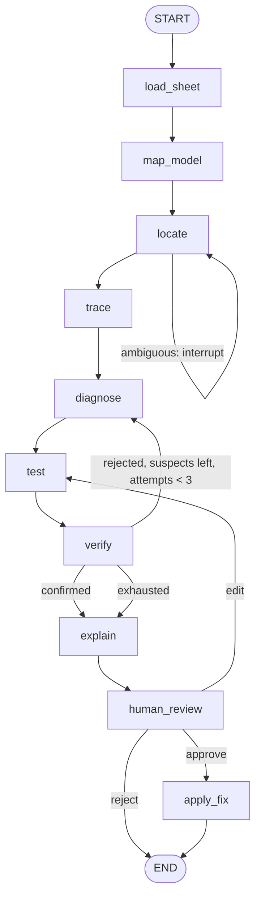

# Agent architecture

Model X-Ray is an evidence-first Nemotron agent that investigates surprising outputs in financial models. Given a question such as "Why did 2027 EBITDA jump 30%?", it locates the cell, traces its inputs, diagnoses the root cause, tests a fix in a sandbox copy, verifies the result, explains it with clickable evidence, and returns a corrected copy after a human approves.

Roadmap: #2. This document: #3.

## Design principles

1. **Nemotron judges, code computes.** Every number comes from deterministic code or from the spreadsheet's own recalculation. The LLM never does arithmetic and may only quote tool results.
2. **Evidence first.** Every claim in the final answer points to a cell, the expected pattern, and a verified before/after value.
3. **Prove the fix.** A diagnosis counts only after the patched sandbox copy recalculates to a result that resolves the anomaly and stays consistent with the model.
4. **The original is never written.** The LLM has no write tool. Only the `apply_fix` node writes, only after human approval, and only to a new corrected copy.
5. **Honest failure.** If no hypothesis survives verification, the agent says the result is inconclusive instead of guessing.

## Platform

Spreadsheets are read through a `SpreadsheetSource` interface and tested through a `Sandbox` interface.

| Adapter | Status | Read | Recalculate |
|---|---|---|---|
| Google Sheets | First | Sheets API with `valueRenderOption=FORMULA` and `UNFORMATTED_VALUE` | Copy with Drive `files.copy`, write the patch, read the values Google recalculated |
| `.xlsx` | Stretch (#13) | `openpyxl` | Python formula engine (`formulas` or `pycel`) |

Google Sheets is first because its sandbox is exact: the recalculated numbers are the ones the user would see, with no formula re-implementation.

Scope for the hackathon: standard models without scripts or macros. Named ranges, `INDIRECT` and `OFFSET` are out of scope unless the demo model needs them.

## Graph



| Node | Kind | What it does | Writes to state |
|---|---|---|---|
| `load_sheet` | Code | Reads values, formulas and labels; builds the dependency graph | (graph cached outside state) |
| `map_model` | Nemotron Nano | Labels rows (revenue, opex, totals) and columns (actuals vs forecast); skipped when the map for this sheet revision is in long-term memory | `model_map_ref` |
| `locate` | Nemotron Super + `find_cells` | Turns the question into a target cell and comparison period; calls `interrupt()` if several cells match | `target`, `messages` |
| `trace` | Code | Precedents of the target and the contribution of each input to the change | `contributions`, `evidence` |
| `diagnose` | Investigator agent (subgraph) | Explores with read-only tools, returns ranked hypotheses with evidence | `hypotheses`, `evidence`, `patch` |
| `test` | Code | Copies the sheet, applies the patch, reads recalculated values | `verifications` (values part) |
| `verify` | Code checks + Verifier agent | Deterministic checks, then an independent attempt to disprove the diagnosis | `verifications`, `hypotheses`, `attempts` |
| `explain` | Nemotron Super | Evidence-linked report, or an honest "inconclusive" | `report` |
| `human_review` | Interrupt | Approve, edit the fix, or reject with a reason | `human_decision` |
| `apply_fix` | Code | Writes a corrected copy with a `Change log` tab | `corrected_copy_id` |

### Routing after `verify`

| Condition | Next node |
|---|---|
| Latest verification is `confirmed` | `explain` |
| `rejected`, untested hypotheses remain, and `attempts < 3` | `diagnose` (with rejected hypotheses in context) |
| Otherwise | `explain`, marked inconclusive |

### Routing after `human_review`

| Decision | Next node | Side effect |
|---|---|---|
| `approve` | `apply_fix` | Finding stored in long-term memory |
| `edit` | `test` | The human's patch replaces the agent's |
| `reject` | `END` | If the reason is "intentional", an override is stored in long-term memory |

## Agents

Three steps need judgment, so three agents. Everything else is a plain Python node.

| Agent | Model | Tools | Job |
|---|---|---|---|
| Investigator | Nemotron 3 Super | Read-only only | ReAct loop (`ToolNode` + `tools_condition`) inside a subgraph with its own private messages. Tells real errors from deliberate overrides, ranks hypotheses, proposes a patch |
| Verifier | Nemotron 3 Super, separate prompt | None (receives evidence and values) | Tries to disprove the diagnosis. Independent of the Investigator's reasoning |
| Model mapper | Nemotron 3 Nano | None | One structured-output call per sheet revision to build the semantic map |

Model assignment is provisional until the tool-calling spike (#4) reports results.

## State

The graph routes on structured fields and the evidence view displays them, so state is not messages only. Each key has a deliberate reducer: no annotation means the new value overwrites the old one.

```python
class InvestigationState(TypedDict):
    messages: Annotated[list[AnyMessage], add_messages]
    spreadsheet_id: str
    question: str
    model_map_ref: str | None
    target: TargetCell | None
    contributions: list[Contribution]
    hypotheses: Annotated[list[Hypothesis], merge_by_id]
    patch: Patch | None
    verifications: Annotated[list[Verification], operator.add]
    evidence: Annotated[list[Evidence], operator.add]
    attempts: int
    report: str | None
    human_decision: HumanDecision | None
    corrected_copy_id: str | None
```

| Key | Reducer | Why |
|---|---|---|
| `messages` | `add_messages` | Conversation with the user only; appends, and replaces by message id |
| `target`, `patch`, `report`, `human_decision`, `corrected_copy_id` | Overwrite | One current value |
| `contributions` | Overwrite | Recomputed as a whole by `trace` |
| `hypotheses` | `merge_by_id` (custom) | The Verifier updates a hypothesis status in place; new ids append; never duplicates |
| `verifications`, `evidence` | `operator.add` | Append-only audit trail behind "show me the evidence" |
| `attempts` | Overwrite | Incremented by `verify` |

The Investigator's tool-calling messages live in the subgraph's private state, so they do not clutter the main conversation.

Schemas at the boundary: the graph accepts `spreadsheet_id` and `question` (input schema) and returns `report`, `patch`, `evidence` and `corrected_copy_id` (output schema).

### Records

| Record | Fields |
|---|---|
| `TargetCell` | `sheet`, `cell`, `label`, `period`, `value`, `prior_cell`, `prior_value` |
| `Contribution` | `cell`, `label`, `delta` |
| `Hypothesis` | `id`, `cell`, `error_type`, `claim`, `evidence_ids`, `confidence`, `status` (`open`, `rejected`, `confirmed`) |
| `Patch` | `cell`, `old_formula`, `new_formula`, `source` (`agent`, `human`) |
| `Verification` | `hypothesis_id`, `before`, `after`, `checks`, `verdict`, `reason` |
| `Evidence` | `id`, `cell`, `kind` (`anomaly`, `expected_pattern`, `verification`), `text` |
| `HumanDecision` | `action` (`approve`, `edit`, `reject`), `reason`, `patch` |

## Tools

| Tool | Access | Used by |
|---|---|---|
| `find_cells(label, period)` | Read-only | `locate`, Investigator |
| `get_cell(ref)` | Read-only | Investigator |
| `trace_precedents(ref, depth)` | Read-only | `trace`, Investigator |
| `trace_dependents(ref, depth)` | Read-only | Investigator, `verify` |
| `explain_change(ref, from_period, to_period)` | Read-only | `trace`, Investigator |
| `row_pattern(ref)` | Read-only | Investigator |
| `scan_anomalies(range)` | Read-only | Investigator |
| `create_copy`, `apply_patch`, `read_values`, `discard` | Sandbox | `test` only |
| `write_corrected_copy` | Write | `apply_fix` only, after approval |

## Error types in scope

1. A typed value replacing a formula
2. A broken or wrong reference
3. An inconsistent range (for example a SUM that skips a row)
4. A sign or period inconsistency

The rule scanner and the tool set are extensible to further model-risk patterns after the hackathon.

## Human in the loop

Both pauses use `interrupt()` inside the node and resume with `Command(resume=...)`, which replaces the older `interrupt_before` and `NodeInterrupt` patterns.

1. **Clarify** in `locate`, only when the question matches more than one cell.
2. **Approve** in `human_review`, always, before anything is written.

## Memory

| Kind | Mechanism | Content |
|---|---|---|
| Short-term | Checkpointer (`SqliteSaver`), one `thread_id` per investigation | Full state after every node: enables pause and resume for the human, and time travel for debugging |
| Long-term | LangGraph Store | `("models", spreadsheet_id)`: model map per sheet revision. `("findings", spreadsheet_id)`: confirmed fixes. `("overrides", spreadsheet_id)`: cells a human marked as intentional, read by the Investigator so they are not flagged again |

Details: #11.

## Models

| Use | Model ID |
|---|---|
| Investigator, Verifier, `locate`, `explain` | `nvidia/nemotron-3-super-120b-a12b` |
| Model mapper | `nvidia/nvidia-nemotron-3-nano-30b-a3b` |

Both run on Nebius Token Factory through LangChain's `ChatOpenAI` with `base_url=https://api.tokenfactory.us-central1.nebius.com/v1/` and `NEBIUS_API_KEY` from `.env`. Confirm IDs in the console before hardcoding (#4).

## Evaluation

Every node is measured against its own metric, and the whole agent runs on generated models: X models per error type, X with blended errors, plus override and clean controls. Accuracy and latency per error type and per step form the project's conclusion. Details: `docs/evaluation.md`.

## Not in scope for the hackathon

- Peer, WACC and terminal-growth assumption checks
- Scripts, macros, `.xls`, external workbooks
- Editing the user's original spreadsheet

## Open questions

- Hosted demo: do users share sheets with the service account, or sign in with OAuth? (#14)
- Where long-term memory lives on the hosted demo (#11)
- Whether Nano is reliable enough for `locate` to cut cost (#4)
