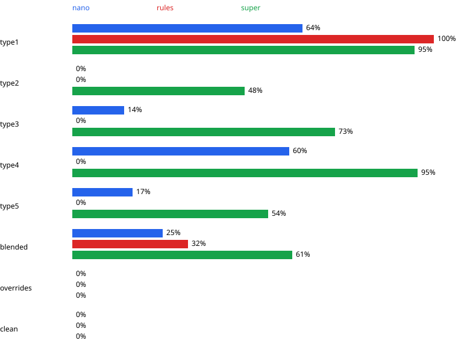

# Benchmark results

174 variants, dataset seed 42, run 2026-10-19. Set-ups in this report: rules, nano, super, no-tools.

304 of 696 investigations failed with errors; their rows carry an `error` field and are excluded from every table.

## Results per set

| Set-up | Set | n | Root cause top-1 (95% CI) | Fix accuracy | False alarms | Inconclusive | Latency p50 / p95 | Cost / investigation |
|---|---|---|---|---|---|---|---|---|
| nano | blended | 8 | 25% [7%, 59%] | 0.16 | 0% | 100% | 97.4 / 336.3 s | $0.0072 |
| nano | clean | 4 | 0% [0%, 49%] | - | 25% | 0% | 140.9 / 369.8 s | $0.0078 |
| nano | overrides | 10 | 0% [0%, 28%] | - | 20% | 0% | 34.6 / 321.3 s | $0.0043 |
| nano | type1 | 11 | 64% [35%, 85%] | 0.46 | 0% | 91% | 115.1 / 236.5 s | $0.0080 |
| nano | type2 | 1 | 0% [0%, 79%] | 0.00 | 0% | 100% | 64.0 / 64.0 s | $0.0035 |
| nano | type3 | 7 | 14% [3%, 51%] | 0.27 | 0% | 86% | 124.7 / 287.0 s | $0.0082 |
| nano | type4 | 5 | 60% [23%, 88%] | 0.99 | 0% | 40% | 126.7 / 158.2 s | $0.0075 |
| nano | type5 | 18 | 17% [6%, 39%] | 0.17 | 0% | 100% | 41.5 / 100.0 s | $0.0032 |
| rules | blended | 25 | 32% [17%, 52%] | 0.00 | 0% | 100% | 0.1 / 0.2 s | $0.0000 |
| rules | clean | 12 | 0% [0%, 24%] | - | 100% | 0% | 0.0 / 0.1 s | $0.0000 |
| rules | overrides | 12 | 0% [0%, 24%] | - | 100% | 0% | 0.1 / 0.1 s | $0.0000 |
| rules | type1 | 25 | 100% [87%, 100%] | 0.00 | 0% | 100% | 0.1 / 0.3 s | $0.0000 |
| rules | type2 | 25 | 0% [0%, 13%] | 0.00 | 0% | 100% | 0.1 / 0.3 s | $0.0000 |
| rules | type3 | 25 | 0% [0%, 13%] | 0.00 | 0% | 100% | 0.1 / 0.2 s | $0.0000 |
| rules | type4 | 25 | 0% [0%, 13%] | 0.00 | 0% | 100% | 0.1 / 0.3 s | $0.0000 |
| rules | type5 | 25 | 0% [0%, 13%] | 0.00 | 0% | 100% | 0.1 / 0.2 s | $0.0000 |
| super | blended | 23 | 61% [41%, 78%] | 0.53 | 0% | 61% | 12.3 / 17.0 s | $0.0081 |
| super | clean | 12 | 0% [0%, 24%] | - | 0% | 0% | 7.8 / 11.2 s | $0.0053 |
| super | overrides | 11 | 0% [0%, 26%] | - | 0% | 0% | 7.2 / 14.4 s | $0.0048 |
| super | type1 | 19 | 95% [75%, 99%] | 0.95 | 0% | 11% | 12.5 / 16.4 s | $0.0080 |
| super | type2 | 21 | 48% [28%, 68%] | 0.51 | 0% | 38% | 13.6 / 18.2 s | $0.0088 |
| super | type3 | 22 | 73% [52%, 87%] | 0.73 | 0% | 32% | 12.4 / 15.8 s | $0.0090 |
| super | type4 | 22 | 95% [78%, 99%] | 0.97 | 0% | 23% | 13.9 / 16.5 s | $0.0101 |
| super | type5 | 24 | 54% [35%, 72%] | 0.54 | 0% | 100% | 13.4 / 16.5 s | $0.0068 |

## Per step

Aggregated across all sets in this run.

| Set-up | Locate exact | Auto-pick accuracy | Trace recall | Verdict P / R | Parse share | Edge recall |
|---|---|---|---|---|---|---|
| rules | 100% | 1.00 | 1.00 | 1.00 / 0.78 | 1.00 | 0.99 |
| nano | 100% | 1.00 | 1.00 | 0.98 / 0.50 | 1.00 | 0.98 |
| super | 100% | 1.00 | 1.00 | 0.96 / 0.49 | 1.00 | 0.99 |

## Latency and tokens per step

| Set-up | Node | Latency p50 (ms) |
|---|---|---|
| rules | apply_fix | 0 |
| rules | choose_target | 0 |
| rules | diagnose | 3 |
| rules | explain | 0 |
| rules | human_review | 0 |
| rules | load_sheet | 0 |
| rules | locate | 2 |
| rules | map_model | 0 |
| rules | test | 0 |
| rules | trace | 23 |
| rules | verify | 0 |
| nano | apply_fix | 0 |
| nano | choose_target | 0 |
| nano | diagnose | 74,317 |
| nano | explain | 0 |
| nano | human_review | 0 |
| nano | load_sheet | 0 |
| nano | locate | 1 |
| nano | map_model | 0 |
| nano | test | 0 |
| nano | trace | 18 |
| nano | verify | 0 |
| super | apply_fix | 19 |
| super | choose_target | 0 |
| super | diagnose | 10,966 |
| super | explain | 0 |
| super | human_review | 0 |
| super | load_sheet | 0 |
| super | locate | 1 |
| super | map_model | 0 |
| super | test | 4 |
| super | trace | 22 |
| super | verify | 1,292 |

| Set-up | LLM role | Calls | Input tokens | Cost |
|---|---|---|---|---|
| nano | investigator | 654 | 1,535,013 | $0.3345 |
| nano | verifier | 33 | 44,015 | $0.0406 |
| super | investigator | 1226 | 3,114,189 | $1.0992 |
| super | verifier | 179 | 266,306 | $0.1250 |

## Confusion matrix (predicted → planted)

| Set-up | Prediction | Count |
|---|---|---|
| nano | typed_value → typed_value | 13 |
| nano | sign_inconsistency → sign_inconsistency | 5 |
| nano | period_inconsistency → period_inconsistency | 2 |
| nano | typed_value → range_inconsistency | 2 |
| nano | range_inconsistency → range_inconsistency | 1 |
| nano | typed_value → period_inconsistency | 1 |
| nano | typed_value → sign_inconsistency | 1 |
| nano | typed_value → wrong_reference | 1 |
| nano | wrong_reference → period_inconsistency | 1 |
| rules | typed_value → typed_value | 33 |
| rules | typed_value → wrong_reference | 32 |
| rules | typed_value → period_inconsistency | 30 |
| rules | typed_value → sign_inconsistency | 30 |
| rules | typed_value → range_inconsistency | 25 |
| super | sign_inconsistency → sign_inconsistency | 26 |
| super | typed_value → typed_value | 25 |
| super | wrong_reference → period_inconsistency | 15 |
| super | range_inconsistency → range_inconsistency | 14 |
| super | wrong_reference → wrong_reference | 11 |
| super | typed_value → wrong_reference | 3 |
| super | sign_inconsistency → period_inconsistency | 2 |
| super | wrong_reference → range_inconsistency | 2 |
| super | typed_value → sign_inconsistency | 1 |

## Conclusion

Top-1 root-cause accuracy: type1 rules 100% (87%-100%), type2 super 48% (28%-68%), type3 super 73% (52%-87%), type4 super 95% (78%-99%), type5 super 54% (35%-72%), blended super 61% (41%-78%). False alarms on the overrides set range from 0% (super) to 100% (rules). False alarms on the clean set range from 0% (super) to 100% (rules). Fix accuracy on the error sets averages 70% for super and 34% for nano and 0% for rules. The inconclusive rate ranges from 33% (super) to 75% (rules). Cost per investigation averages $0.0076 for super and $0.0000 for rules, with p50 latencies of 11.6 s and 0.1 s.

## Chart

